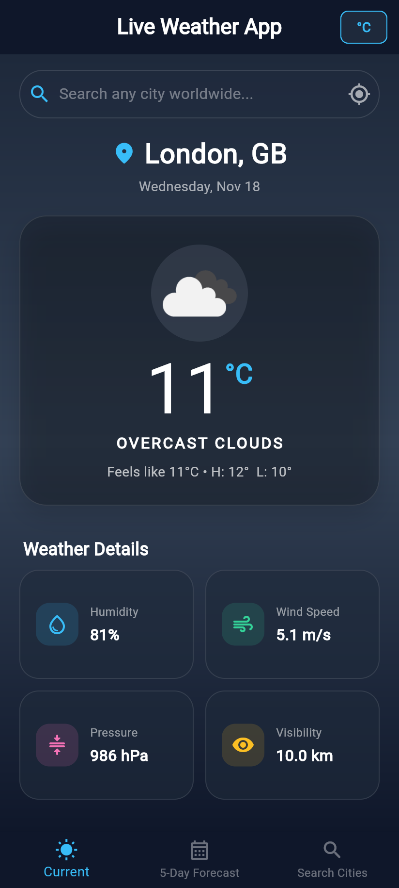
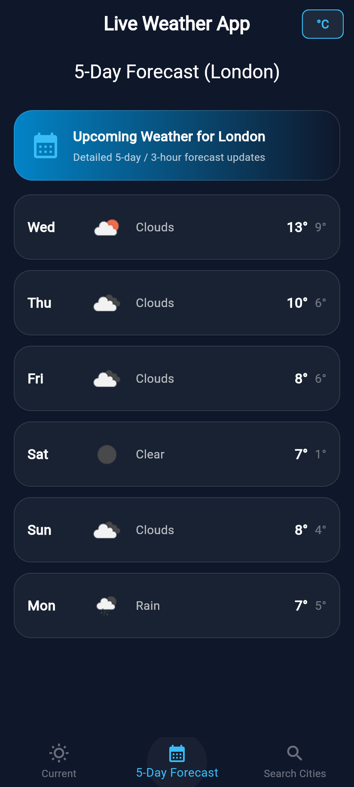
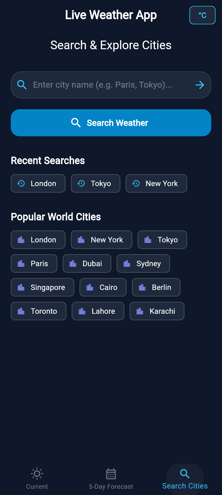
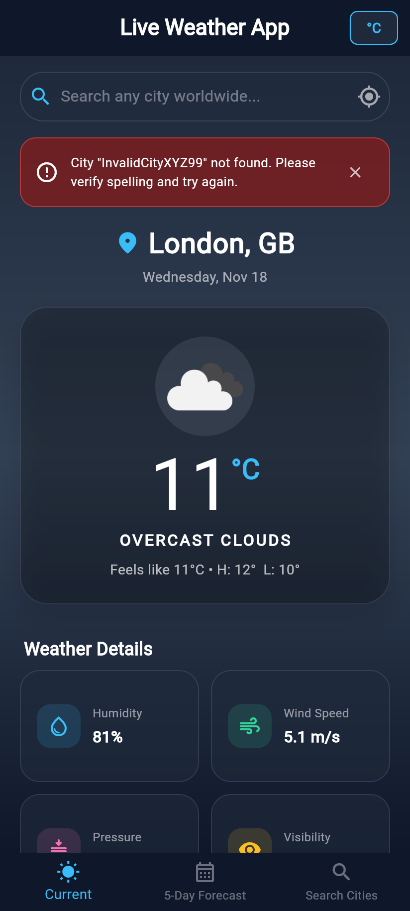

# Weather App in Flutter (Assignment 3)

## 📌 Project Overview & Objective
This repository contains a fully functional Weather Application built with **Flutter** using the **OpenWeatherMap REST API**. The app fetches and displays real-time weather information and extended 5-day forecasts in an attractive, responsive, and user-friendly interface.

- **Framework**: Flutter 3.x (Dart 3.x)
- **API Provider**: [OpenWeatherMap.org](https://openweathermap.org/)
- **Target Platforms**: Android, iOS, Web, Windows Desktop

---

## 🚀 Key Features

1. **Real-Time Weather Data**:
   - Fetches live temperature, weather conditions, feels-like temperature, and high/low ranges.
   - Dynamic weather icons directly mapped from OpenWeatherMap weather codes.
   - Comprehensive weather metrics: **Humidity (%)**, **Wind Speed (m/s)**, **Atmospheric Pressure (hPa)**, and **Visibility (km)**.

2. **Clean & Modern UI**:
   - Dark aesthetic with dynamic weather gradients matching atmospheric conditions (Clear, Clouds, Rain, Thunderstorm, Snow).
   - Glassmorphic card styling with smooth visual hierarchy and Material 3 design principles.
   - Convenient unit conversion toggle (**°C / °F**) in the top app bar.

3. **City Search & Exploration**:
   - Instant search bar directly at the top of the home screen.
   - Dedicated **Search & Explore** tab with popular city quick-chips (London, Tokyo, New York, Paris, Dubai, Sydney, Singapore, Cairo, Lahore, etc.).
   - Persistent recent search history chips for quick navigation.

4. **Detailed 5-Day Forecast**:
   - Dedicated forecast tab displaying upcoming daily temperature projections, high/low comparisons, and condition descriptions.

5. **Robust Error Handling**:
   - Clear feedback banner when a user enters an invalid or non-existent city name.
   - Network failure and offline detection with friendly error prompts and a "Retry Connection" button.
   - Graceful fallback for location services when GPS permissions are unavailable.

---

## 📸 Screenshots

| 1. Live Weather Home Screen | 2. 5-Day Forecast Screen |
| :---: | :---: |
|  |  |

| 3. City Search & Popular Cities | 4. Error Handling (Invalid City) |
| :---: | :---: |
|  |  |

---

## 📁 Assignment Folder Structure

```text
Assignment 3/
├── lib/
│   ├── main.dart             # Core application code, UI screens & API integration
│   └── theme6070.dart        # Custom theme definitions & weather styling
├── pubspec.yaml              # Flutter dependencies and environment config
├── README.md                 # Project documentation & screenshot preview
└── screenshots/              # Working application screenshots
    ├── screenshot1_weather_home.png
    ├── screenshot2_5day_forecast.png
    ├── screenshot3_search_cities.png
    └── screenshot4_error_handling.png
```

---

## 🛠️ How to Run the App

1. Ensure Flutter is installed on your machine (`flutter --version`).
2. Navigate to the project directory:
   ```bash
   cd Weather_App
   ```
3. Fetch dependencies:
   ```bash
   flutter pub get
   ```
4. Run the app on your preferred connected device:
   ```bash
   # Run on Chrome
   flutter run -d chrome

   # Run on Windows Desktop
   flutter run -d windows

   # Run on connected Android device / emulator
   flutter run
   ```

---

## 🔑 OpenWeatherMap API Integration
The app uses the OpenWeatherMap 2.5 API endpoints:
- **Current Weather**: `https://api.openweathermap.org/data/2.5/weather?q={city}&appid={apiKey}&units=metric`
- **5-Day Forecast**: `https://api.openweathermap.org/data/2.5/forecast?q={city}&appid={apiKey}&units=metric`

